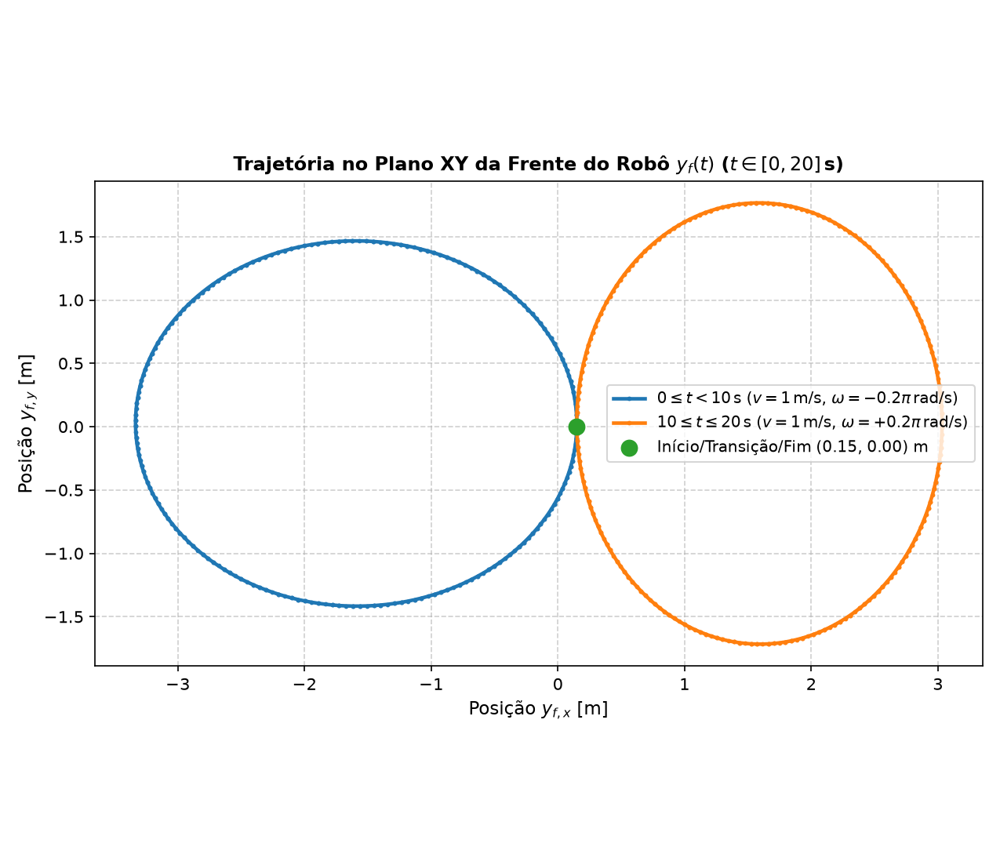
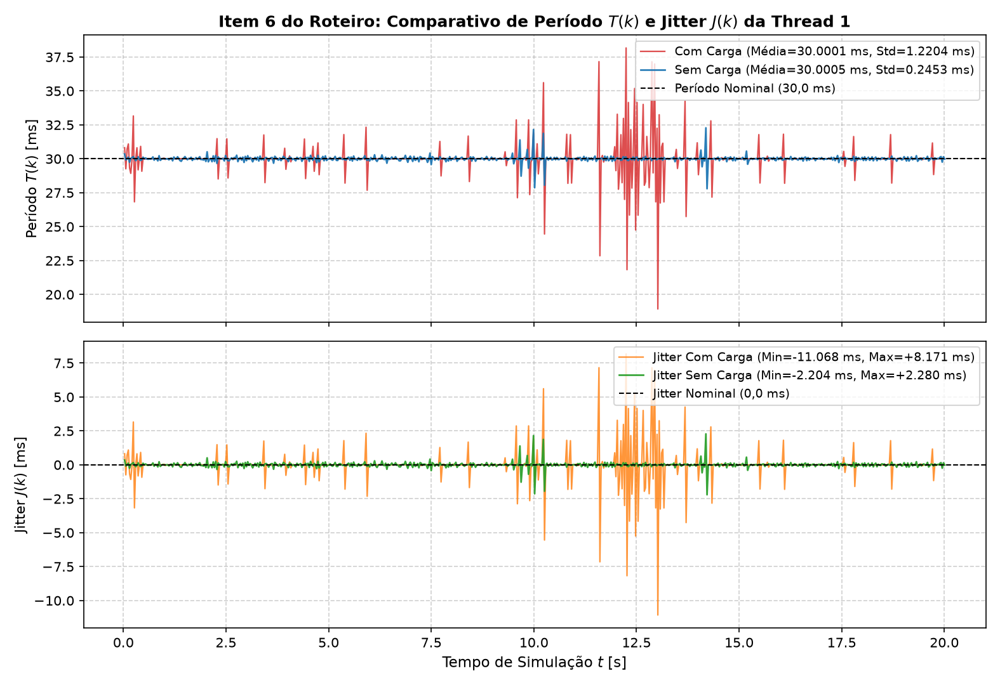
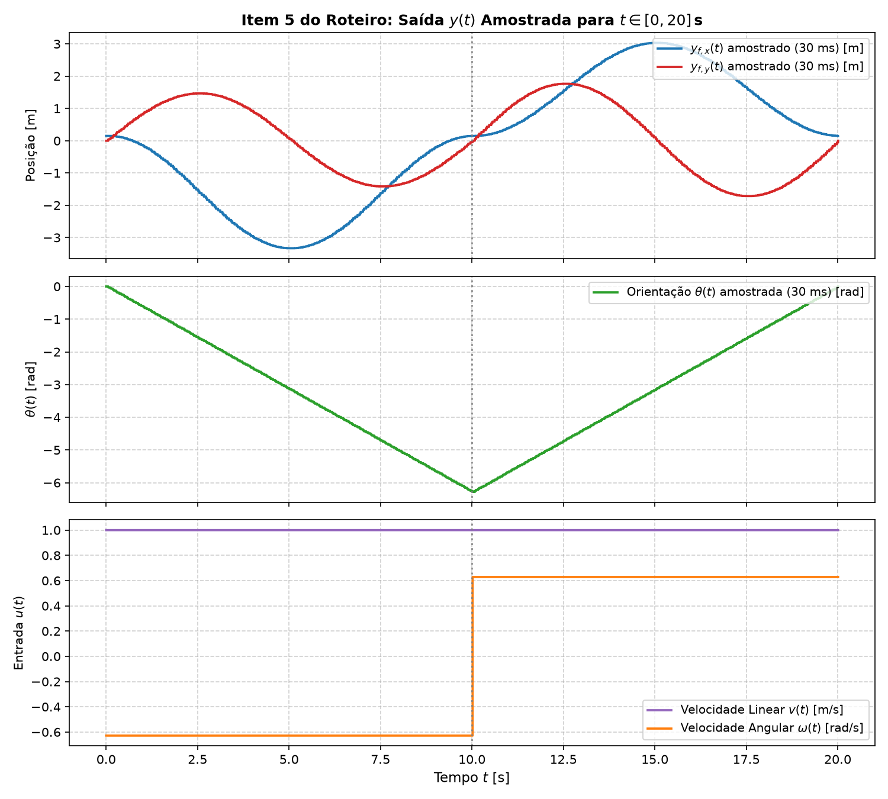
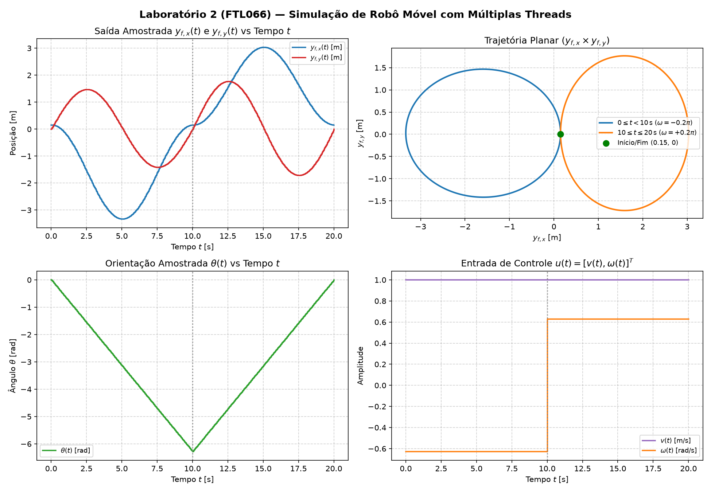
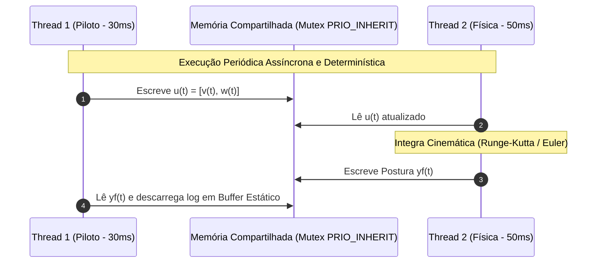

# Real-Time Multi-Rate Simulation Engine: Differential Drive Mobile Robot

[](https://en.wikipedia.org/wiki/C99)
[](#-padrões-de-código-e-engenharia-de-missão-crítica)
[-brightgreen.svg)](#-compilação-e-execução)
[](#-pilares-de-arquitetura-e-tempo-real)
[](#-comunicação-inter-threads-ipc-e-concorrência)
[](LICENSE)

Simulador concorrente em tempo real para robôs móveis com tração diferencial, projetado sob os princípios de software de **missão crítica** e sistemas embarcados determinísticos. 

O sistema implementa uma arquitetura **multi-taxa e assíncrona** em C99 estrito com POSIX Threads, mitigação ativa de inversão de prioridade (`PTHREAD_PRIO_INHERIT`), temporização absoluta sem acúmulo de *drift* (`clock_nanosleep`) e rastreamento contínuo de jitter temporal via **Algoritmo de Welford**.

---

## 📊 Validação Experimental & Telemetria em Tempo Real

Abaixo estão os resultados das simulações nominais e os testes de estresse de CPU gerados automaticamente pela pipeline de validação:

| Trajetória 2D da Postura Frontal $y_f(t)$ | Análise de Jitter Temporal: Nominal vs. 16 Threads de Carga |
| :---: | :---: |
|  |  |

| Curvas de Estado e Sinais de Controle $u(t) = [v, \omega]^T$ | Dashboard Consolidado de Telemetria |
| :---: | :---: |
|  |  |

> 📑 **Documentação Técnica Completa:**  
> O relatório técnico formal de engenharia com fundamentação matemática da cinemática e análise detalhada dos testes de estresse está disponível em [`report/technical_report.pdf`](report/technical_report.pdf).

---

## 🏛️ Pilares de Arquitetura e Tempo Real

### 1. Esquema Concorrente Multi-Taxa (Multi-Rate & Asynchronous)
O sistema desacopla o laço de controle/telemetria do motor de física contínua por meio de duas threads POSIX periódicas com frequências distintas:

| Thread | Período ($T$) | Frequência | Prioridade / Responsabilidade |
| :--- | :---: | :---: | :--- |
| **Thread 1 (Piloto & Telemetria)** | **30 ms** | 33,33 Hz | Amostra a postura $y_f(t)$, sintetiza sinais de controle $u(t)$, calcula métricas e grava telemetria em buffer estático de I/O. |
| **Thread 2 (Motor de Física)** | **50 ms** | 20,00 Hz | Integra a cinemática não-linear contínua discretizada pelo método de Euler e atualiza a postura frontal $y_f(t) = [x + d\cos\theta, y + d\sin\theta]^T$. |



### 2. Temporização Absoluta sem Drift
- Utiliza `clock_nanosleep` associado ao relógio monotônico do kernel (`CLOCK_MONOTONIC`) e a flag `TIMER_ABSTIME`.
- O cálculo do próximo ciclo periódico é baseado em tempo absoluto (`next_time = next_time + period`), eliminando completamente o acúmulo de atrasos (*phase drift*) comum a abordagens com tempos relativos (`usleep` ou `sleep`).

### 3. Prevenção de Inversão de Prioridade
- A comunicação entre threads ocorre por memória compartilhada protegida exclusivamente por mutex POSIX.
- Para prevenir cenários clássicos de inversão de prioridade (como o ocorrido na missão *Mars Pathfinder*), o mutex é explicitamente configurado com o atributo de **Herança de Prioridade**:
  ```c
  pthread_mutexattr_setprotocol(&attr, PTHREAD_PRIO_INHERIT);
  ```

### 4. Estatísticas de Jitter com Estabilidade Numérica ($O(1)$)
- O monitoramento de jitter $J(k) = |T(k) - T_{\text{esperado}}|$ e da variância temporal é executado em tempo de execução via **Algoritmo de Welford**.
- Processamento em passo único ($O(1)$ em espaço e tempo), garantindo precisão numérica contra erros de cancelamento catastrófico de ponto flutuante em execuções de longa duração.

---

## 🛡️ Padrões de Código e Engenharia de Missão Crítica

O código-fonte foi desenvolvido seguindo diretrizes rigorosas adotadas nas indústrias automotiva, aeroespacial e de defesa (**BARR-C:2018**, **MISRA C:2023** e **NASA JPL Power of Ten**):

1. **Zero Alocação Dinâmica em Runtime (NASA JPL Rule 3):**
   - Proibido o uso de `malloc`, `calloc`, `realloc` e `free` após o ciclo de inicialização. Todas as estruturas, descritores de thread e buffers de I/O são estáticos (ex.: ring-buffer de telemetria de 64 KB).
2. **Tipos Primitivos de Largura Fixa (BARR-C §1.4):**
   - Adoção estrita de inteiros com sinal e sem sinal padronizados de `<stdint.h>` (`uint8_t`, `uint32_t`, `int32_t`) e booleanos de `<stdbool.h>`.
3. **Programação Defensiva e Verificação de Contratos:**
   - Todas as funções de API pública validam formalmente a nulidade de ponteiros e a consistência dos limites antes do processamento.
4. **Isolamento e Encapsulamento de Módulos:**
   - Todas as variáveis e funções internas são marcadas com linkage interno (`static`). Nenhum estado global é exposto diretamente sem mediação de API thread-safe.

---

## ⚡ Compilação e Execução

### Pré-requisitos
- Sistema operacional Linux (x86_64 ou ARM64)
- Compilador GCC compatível com C99 e suporte a POSIX Threads
- Python 3.8+ (apenas para geração automatizada dos gráficos)

### 1. Execução Rápida (One-Command Pipeline)
Compila em C com flags estritas, executa a simulação de 20s e gera as figuras:
```bash
make sim
```

### 2. Benchmark de Robustez Temporal sob Estresse de CPU
Executa a simulação nominal (**Sem Carga**) e repete a rodada sob estresse severo (**Com Carga** usando 16 threads concorrentes de CPU intensiva). Ao final, compara estatisticamente o impacto do escalonador no jitter:
```bash
make benchmark
```

### 3. Pipeline Individual
```bash
# Compilação estrita: -Wall -Wextra -Werror -pedantic -std=c99 -pthread
make

# Executa o binário compilado em C
./build/robot_sim

# Gera os gráficos da simulação a partir do log gerado
make plot

# Limpeza de binários e dados gerados
make clean
```

---

## 🎮 Simulador Visual 2D Interativo (Python)

Além do motor de física em tempo real em C, o repositório inclui um simulador gráfico complementar construído em Python (`tkinter` + `numpy`) para inspeção de rota e controle manual:

```bash
cd python_sim
make
```

- **Visualização do Circuito:** Traçado do circuito em "8" contínuo com diferenciação de sentidos (anti-horário e horário).
- **Orientação Frontal:** Exibição da postura do robô com marcador vetorial da frente ($y_f$).
- **Controle por Teclado:** Permite navegar e validar manualmente o comportamento cinemático.

---

## 📁 Estrutura do Repositório

```text
.
├── Makefile                    # Pipeline de compilação C99 (-Werror) e automação de testes
├── README.md                   # Documentação arquitetural e métricas de engenharia
├── LICENSE                     # Licença MIT
├── include/                    # Contratos e cabeçalhos públicos (.h)
│   ├── kinematics.h            # Modelagem cinemática discreta do robô diferencial
│   ├── shared_mem.h            # IPC thread-safe com PTHREAD_PRIO_INHERIT
│   └── rt_timer.h              # Temporizador CLOCK_MONOTONIC e Welford on-line
├── src/                        # Implementações de baixo nível (.c)
│   ├── main.c                  # Ponto de entrada, orquestração POSIX e buffer estático de I/O
│   ├── kinematics.c            # Integração numérica da cinemática e cálculo de postura frontal
│   ├── shared_mem.c            # Primitivas de sincronização e memória compartilhada
│   └── rt_timer.c              # Temporização TIMER_ABSTIME e acumuladores de Welford
├── scripts/                    # Automação de testes e análise de dados
│   ├── plot_results.py         # Pipeline de telemetria e gráficos (matplotlib/numpy)
│   └── run_stress_and_plot.py  # Harness de benchmark sob estresse de 16 threads
├── python_sim/                 # Simulador visual interativo 2D complementar
├── report/                     # Relatório técnico formal de validação (technical_report.pdf)
├── assets/                     # Gráficos de telemetria e ilustrações da documentação
├── data/                       # Diretório para logs e saídas de telemetria
└── build/                      # Artefatos compilados (.o) e executável final
```

---

## 👨‍💻 Autor

**José Dercy Vieira da Silva Filho**  
- Email: [josedercysilva@gmail.com](mailto:josedercysilva@gmail.com)  
- LinkedIn: [linkedin.com/in/josedercy](https://linkedin.com/in/josedercy) *(ajuste com seu link)*  
- GitHub: [github.com/josedercy](https://github.com/josedercy) *(ajuste com seu usuário)*  
